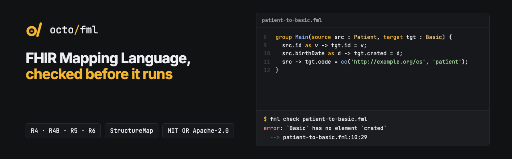

<p align="center"></p>

<p align="center"><b>The FHIR Mapping Language, in Rust: parse, format, type-check, compile and run FML maps. No JVM.</b></p>

<p align="center">
  <a href="https://github.com/octofhir/fml-rs/actions/workflows/ci.yml"></a>
  <a href="#license"></a>
</p>

Use [FML](https://build.fhir.org/ig/HL7/mapping-language-ig/) maps from a single `fml` binary or
as a library.

```sh
$ fml check syntax.map
error: `Basic` has no element `identifer`
  --> syntax.map:14:25
   |
14 |   src.identifier -> tgt.identifer;
   |                         ^^^^^^^^^

$ fml run Encounter4to5.fml encounter-r4.json --maps R4toR5/ --maps codes/
{ "resourceType": "Encounter", "class": [{ "coding": [{ "code": "IMP", … }] }], … }
```

## What it does, measured

Every number below is checked by a test in this repository against public data, in CI.

| | |
|---|---|
| **Parses real maps** | All 1,659 public maps we test against parse without errors: the HL7 [cross-version maps](https://github.com/HL7/fhir-cross-version), the [R6 maps](https://github.com/brianpos/fhir-r6-maps), the Mapping Language IG examples and the [FHIR test cases](https://github.com/FHIR/fhir-test-cases). |
| **Compiles like the reference** | On all 1,659, the StructureMap JSON is identical to what the HL7 reference compiler (org.hl7.fhir.core, the one the IG Publisher and the validator use) builds, apart from two documented places where we keep what the map says. |
| **Runs like the reference** | Passes every JSON structure-mapping test of the FHIR test cases (12 of 12, R4B and R5). |
| **Converts FHIR versions** | With the HL7 cross-version maps, converts 2,863 of the 2,881 R4 specification examples that have a map to R5. |
| **Finds mistakes** | Its type checker found a typo in the FHIR test cases, a group in the R6 maps that uses a parameter it never declares, and a condition there that can never be true. |
| **Round-trips** | FML → StructureMap → FML → StructureMap gives back the same StructureMap for every map, and the formatter never changes a map's meaning or loses a comment. |

## Install

```sh
cargo install --git https://github.com/octofhir/fml-rs fml-cli
```

Releases also carry ready-built `fml` binaries for Linux (x64, arm64), macOS (arm64, x64) and
Windows (x64) on the [releases page](https://github.com/octofhir/fml-rs/releases).

## The `fml` command

```sh
fml check maps/                    # syntax and type errors, rustc-style
fml check --format json maps/      # the same, for editors and CI
fml fmt maps/                      # format in place
fml fmt --check maps/              # list unformatted files, exit 1 (CI)
fml compile map.fml -o map.json    # FML → StructureMap (--fhir r4 for the R4 form)
fml print map.json                 # StructureMap (R4 or R5) → FML
fml run map.fml input.json         # run a map over a FHIR resource
fml run Patient4to5.fml patient.json --maps R4toR5/ --maps codes/
                                   # with imported groups and ConceptMaps for translate()
fml run map.fml in.json --debug    # the $transform debug trace, as Parameters
fml run map.fml in.json --bundle   # the target and the resources the map produced
fml check --package hl7.fhir.us.core@6.1.0 maps/
                                   # with the profiles and extensions of a FHIR package
```

## The crates

| Crate | |
|---|---|
| [`fml-syntax`](crates/fml-syntax) | Lossless syntax tree, error-tolerant parser, formatter that keeps comments. |
| [`fml-model`](crates/fml-model) | StructureMap model; FML → StructureMap like the reference compiler; StructureMap → FML; R4 and R5 forms. |
| [`fml-check`](crates/fml-check) | Type checker against FHIR R4, R4B, R5 and R6 definitions and FHIR packages: paths, types, variables, group calls, FHIRPath paths. |
| [`fml-engine`](crates/fml-engine) | StructureMap engine over FHIR JSON, with FHIRPath, imported maps, ConceptMaps and a debug trace. |
| [`fml-cli`](crates/fml-cli) | The `fml` binary. |

```rust
let compiled = fml_model::compile(source);       // StructureMap + diagnostics
let diagnostics = fml_check::check(&fml_syntax::parse(source).tree(), &definitions);
let output = fml_engine::Engine::new(&definitions, expressions)
    .with_maps(&maps)
    .with_concept_maps(&concept_maps)
    .transform(&compiled.map, &input)
    .await?;                                     // output.target is FHIR JSON
```

## Details

**Parser.** A hand-written parser over a lossless [rowan](https://github.com/rust-analyzer/rowan)
tree: every byte of the input is kept, a syntax error becomes a diagnostic without stopping the
parse, and positions come in bytes, lines and UTF-16 columns. Beyond the IG grammar it reads what
real maps use: `map "url" = "name"`, unparenthesised `where`, embedded `conceptmap`, `<<type+>>`.

**Compiler.** Follows `StructureMapUtilities` from org.hl7.fhir.core: generated rule names, the
`vvv` variables of the simple copy form, batch identity rules, contained ConceptMaps, documentation
from comments, and FHIRPath written exactly as the reference parser does. It also builds the
IG's metadata the reference compiler ignores (`/// jurisdiction.coding.code = 'AQ'`), and records
where each group, rule, source and target is in the text. The one deliberate difference:
calendar durations (`5 days`), which the reference compiler rewrites as `5 'days'`.
`scripts/reference.sh` runs the reference compiler over the corpus to check this.

**Type checker.** Follows each rule with the types of its variables, including untyped groups,
checked with the types they are called with, and the version-specific URLs of the cross-version
maps (`http://hl7.org/fhir/4.0/StructureDefinition/Patient`). It reports missing elements, wrong
type annotations, unknown variables, writes into source variables, unknown or abstract types in
`create`, wrong transform arity and wrong group calls, and checks the element paths inside
FHIRPath as warnings. It reports what the IG requires of a map: `url` and `name`, groups that
extend another with its parameters, typed default groups, unique names. The cross-version maps
check without errors. Profiles, extensions and logical
models come from FHIR packages: a folder, or `name@version` from the package registry.

**Engine.** Groups and `extends`, source filters (type, `where`, `check`, `log`, list modes,
`default`), targets that create or reuse elements (repeating, choice elements written as
`valueReference`, `share`), dependent groups, default groups chosen by type, imported maps, rules
with several sources, and the transforms `create`, `copy`, `evaluate`, `truncate`, `cast`,
`append`, `translate`, `reference`, `pointer`, `uuid`, `cc`, `c`, `id`, `cp`, `qty`, `escape`,
and the IG's date and time transforms (`toDateTime`, `toDate`, `toTime` with format patterns, and
their `unixTo…` forms). FHIRPath comes through a small trait; the `fhirpath` feature uses
[octofhir-fhirpath](https://github.com/octofhir/fhirpath-rs). `translate` picks targets as the
reference engine does and finds ConceptMaps by URL, by `url|version` and by the canonical URLs
they replace, or asks a terminology service (`$translate`) for the rest. Resources a map creates
outside the target are returned as `produced`. Where the IG says more than the reference engine,
it follows the IG: groups and nested rules after `then` both run, source `min..max` is enforced,
`evaluate` with several values fills a repeating element. Limits on depth, rules, values and trace
size, and a cancel flag, make it safe for maps from users. With tracing on, the engine records the
trace of the IG's debug page for `$transform?debug=true`: events with depth, position, text range
and variables, `traceStatus` (`complete`, `truncated`, `stopped`), and an `outcome` that says
where a failure happened.

## Not yet

- Releases to crates.io (the release workflow is ready).
- XML, and with it CDA and the CDA test cases: the tools read and write FHIR JSON.
- The `dateOp` transform, which the IG lists without defining, and time zone names (`z`) in
  date formats.
- WebAssembly, and a language server.

Next: StructureMap `$transform` and version conversion in the
[OctoFHIR](https://github.com/octofhir/server-rs) server.

## Testing

```sh
cargo test                                         # unit and snapshot tests
scripts/fetch-corpus.sh                            # the public maps and FHIR test cases
cargo test --test corpus -- --nocapture            # parse, format, round-trip, type-check
scripts/reference.sh                               # the HL7 reference compiler (needs Java)
cargo test -p fml-model --test reference -- --nocapture
cargo test -p fml-engine --features fhirpath --test test_cases -- --nocapture
cargo test -p fml-engine --features fhirpath --test cross_version -- --nocapture
```

## License

Licensed under either of [Apache License, Version 2.0](LICENSE-APACHE) or
[MIT license](LICENSE-MIT) at your option.
